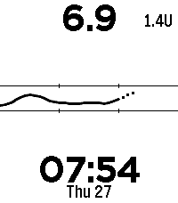

<!-- Generated by scripts/update_app_directory.py: do not edit by hand -->
[← All Pebble Developers](../developers.md)

# Morten F. Amundsen

*1 watchface · Last updated 2026-10-11 · [About these lists](../about-app-lists.md)*

Links: [Pebble App Store](https://apps.repebble.com/apps/dev/morten-f-amundsen_3dc49eda3e8998859607e9dd) · [GitHub (mortenfyhn)](https://github.com/mortenfyhn)

<h2 class="app-name" id="app-b785c22984c843299e95bba0"><a href="https://apps.repebble.com/b785c22984c843299e95bba0">Morten&#x27;s Glucose</a> v0.1.0</h2>
<a class="app-source" href="https://github.com/mortenfyhn/pebble-glucose-watchface" title="Source code" data-search-exclude>View source</a>

Watchface

Released 2026-08-24 Updated 2026-08-24

Runs on: Round 2, Time 2, Pebble 2 Duo, Pebble 2, Time Round, Time, Classic

This is my blood glucose watchface. It can work with any glucose data source. COMPANION APP This watchface uses a generic Pebble Glucose Protocol, and can therefore be made to work with any data…

