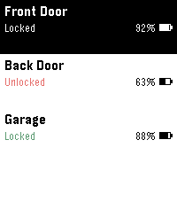

<!-- Generated by scripts/update_app_directory.py: do not edit by hand -->
[← All Pebble Developers](../developers.md)

# Mowken Apps

*1 app · Last updated 2026-10-12 · [About these lists](../about-app-lists.md)*

Links: [Pebble App Store](https://apps.repebble.com/apps/dev/mowken-apps_6a2eb28176550100085bc243) · [GitHub (diced-k)](https://github.com/diced-k)

<h2 class="app-name" id="app-6a2ebb3ee24af40009fa5330"><a href="https://apps.repebble.com/6a2ebb3ee24af40009fa5330">Hirake Goma</a> v1.0</h2>
<a class="app-source" href="https://github.com/diced-k/hirake-goma" title="Source code" data-search-exclude>View source</a>

App · <a href="https://forum.rebble.io/t/1056" title="Discuss this app on the Rebble forum" data-search-exclude>Forum thread</a>

MIT Released 2026-06-14 Updated 2026-06-14

Runs on: Time 2, Pebble 2 Duo, Pebble 2, Time, Classic

Lock, unlock, and check your SESAME (Candy House) smart lock straight from your Pebble. Pick a lock from the menu, then use the action bar buttons — Up to unlock, Down to lock, and the middle…

