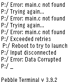

<!-- Generated by scripts/update_app_directory.py: do not edit by hand -->
[← All Pebble Developers](../developers.md)

# MPG13

*1 watchface and 1 app · Last updated 2026-10-11 · [About these lists](../about-app-lists.md)*

Links: [Pebble App Store](https://apps.repebble.com/apps/dev/mpg13_55493e11d6f29a57700000c9) · [GitHub (MPG13)](https://github.com/MPG13)

<button type="button" data-filter="all" aria-pressed="true">All 2</button><button type="button" data-filter="watchface" aria-pressed="false">Watchfaces 1</button><button type="button" data-filter="watchapp" aria-pressed="false">Apps 1</button>

<label class="dev-sort">Sort by <select><option value="updated">Recently updated</option><option value="released">Newest release</option><option value="title">A–Z</option></select></label>

<h2 class="app-name" id="app-56f9b9ea69581d21f800000d"><a href="https://apps.repebble.com/56f9b9ea69581d21f800000d">CrashApp</a> v1.2</h2>
<a class="app-source" href="https://github.com/MPG13/CrashApp" title="Source code" data-search-exclude>View source</a>

App

No licence Released 2016-03-28 Updated 2016-03-28

Runs on: Time 2, Pebble 2 Duo, Pebble 2, Time, Classic

If you&#x27;d rather not give up your watch face to use CrashFace, you can use this. simply re-compiled the face as an app instead.

<h2 class="app-name" id="app-56f9b1a869581dad78000013"><a href="https://apps.repebble.com/56f9b1a869581dad78000013">Crash Simulator</a> v1.0</h2>
<a class="app-source" href="https://github.com/mpg13/crashface" title="Source code" data-search-exclude>View source</a>

Watchface

Released 2016-03-28 Updated 2016-03-28

Runs on: Time 2, Pebble 2 Duo, Pebble 2, Time, Classic

Meant to simulate a crash, this pretends to not be able to load your watch face! No harm is done to your Pebble, 100% guarantee. Also, this doesn&#x27;t tell the time. hehe.

