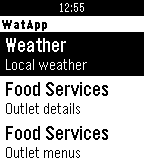

<!-- Generated by scripts/update_app_directory.py: do not edit by hand -->
[← All Pebble Developers](../developers.md)

# MRahman

*1 app · Last updated 2026-10-12 · [About these lists](../about-app-lists.md)*

Links: [Pebble App Store](https://apps.repebble.com/apps/dev/mrahman_52fbdd7cefa89680040003bd) · [GitHub (MunazR)](https://github.com/MunazR)

<h2 class="app-name" id="app-55da162a264607d00d000021"><a href="https://apps.repebble.com/55da162a264607d00d000021">WatApp</a> v1.5</h2>
<a class="app-source" href="https://github.com/MunazR/WatApp" title="Source code" data-search-exclude>View source</a>

App

MIT Released 2015-08-23 Updated 2016-03-22

Runs on: Time 2, Pebble 2 Duo, Pebble 2, Time, Classic

WatApp uses the University of Waterloo Open Data API to display information on your wrist. It includes the following; ~ Weather - Displays the University weather forecast for the day. ~ Food…

