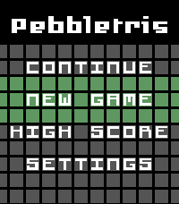

<!-- Generated by scripts/update_app_directory.py: do not edit by hand -->
[← All Pebble Developers](../developers.md)

# MrBlue

*2 apps · Last updated 2026-10-12 · [About these lists](../about-app-lists.md)*

Links: [Pebble App Store](https://apps.repebble.com/apps/dev/mrblue_56dc9f89296282ad2e000034) · [GitHub (mrbluue)](https://github.com/mrbluue)

<button type="button" data-filter="all" aria-pressed="true">All 2</button><button type="button" data-filter="watchface" aria-pressed="false" disabled>Watchfaces 0</button><button type="button" data-filter="watchapp" aria-pressed="false">Apps 2</button>

<label class="dev-sort">Sort by <select><option value="updated">Recently updated</option><option value="released">Newest release</option><option value="title">A–Z</option></select></label>

<h2 class="app-name" id="app-693b187bd8c67a0009650e91"><a href="https://apps.repebble.com/693b187bd8c67a0009650e91">Pebbletris Redux</a> v2.30</h2>
<a class="app-source" href="https://github.com/mrbluue/Tetris-PebbleTime" title="Source code" data-search-exclude>View source</a>

App · <a href="https://forum.rebble.io/t/225" title="Discuss this app on the Rebble forum" data-search-exclude>Forum thread</a>

Released 2025-12-11 Updated 2026-06-18

Runs on: Round 2, Time 2, Pebble 2 Duo, Pebble 2, Time Round, Time, Classic

A new version of the classic game for the future of Pebbles! Inspired by Tetris, this is a fork of the original Tebbletris app by WRansohoff, keeping the same core game and features but with some…

<h2 class="app-name" id="app-596e2e79461a8d34f600006c"><a href="https://apps.repebble.com/596e2e79461a8d34f600006c">Counter</a> v1.2</h2>
<a class="app-source" href="https://github.com/mrbluue/CounterPebble/" title="Source code" data-search-exclude>View source</a>

App

Released 2017-07-18 Updated 2017-07-18

Runs on: Time 2, Pebble 2 Duo, Pebble 2, Time, Classic

Count using the up and down buttons. You can set a limit to how far you want to count. You can also save your counts by long pressing select on the counting screen. (It is not currently possible…

