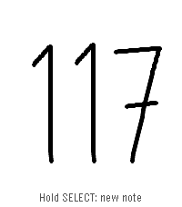

<!-- Generated by scripts/update_app_directory.py: do not edit by hand -->
[← All Pebble Developers](../developers.md)

# MrDenexi

*1 app · Last updated 2026-11-16 · [About these lists](../about-app-lists.md)*

Links: [Pebble App Store](https://apps.repebble.com/apps/dev/mrdenexi_3b4cbaf06ed8a322cb02e17f) · [GitHub (MrDenexi)](https://github.com/MrDenexi)

<h2 class="app-name" id="app-9ee68350807b48edad6f41b8"><a href="https://apps.repebble.com/9ee68350807b48edad6f41b8">Scribbly Note</a> v1.0.0</h2>
<a class="app-source" href="https://github.com/MrDenexi/pebble-scribbly-note" title="Source code" data-search-exclude>View source</a>

App

MIT Released 2026-11-14 Updated 2026-11-14

Runs on: Time 2

A one-time handwritten note for your wrist. At the gym and need to remember your locker number? Open Scribbly Note, scribble &quot;117&quot; with your finger, press SELECT. Done. When you&#x27;re back, open the…

