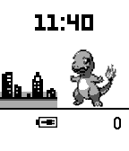

<!-- Generated by scripts/update_app_directory.py: do not edit by hand -->
[← All Pebble Developers](../developers.md)

# MrDrake

*3 watchfaces · Last updated 2026-10-12 · [About these lists](../about-app-lists.md)*

Links: [Pebble App Store](https://apps.repebble.com/apps/dev/mrdrake_568f42fc40353f81d5000036) · [GitHub (MrDrake)](https://github.com/MrDrake)

<button type="button" data-filter="all" aria-pressed="true">All 3</button><button type="button" data-filter="watchface" aria-pressed="false">Watchfaces 3</button><button type="button" data-filter="watchapp" aria-pressed="false" disabled>Apps 0</button>

<label class="dev-sort">Sort by <select><option value="updated">Recently updated</option><option value="released">Newest release</option><option value="title">A–Z</option></select></label>

<h2 class="app-name" id="app-56b25ac4bbe212ebff000030"><a href="https://apps.repebble.com/56b25ac4bbe212ebff000030">Pébble Walker</a> v1.1</h2>
<a class="app-source" href="https://github.com/MrDrake/pebblewalker" title="Source code" data-search-exclude>View source</a>

Watchface

GPL-2.0 Released 2016-02-03 Updated 2016-02-06

Runs on: Round 2, Time 2, Time Round, Time

The first Pokéwalker watchface that displays your step count! A classic look, with multiple Pokémon and routes to choose from. Battery charge icon, and 12 or 24 hour display. Watch out for updates!

<h2 class="app-name" id="app-569490b44ccd6c997d000051"><a href="https://apps.repebble.com/569490b44ccd6c997d000051">MegaWatch</a> v1.0</h2>
<a class="app-source" href="https://github.com/MrDrake/megawatch" title="Source code" data-search-exclude>View source</a>

Watchface

GPL-2.0 Released 2016-01-12 Updated 2016-01-12

Runs on: Time 2, Time

Have you ever wanted to mega-evolve your Pokémon with your Pebble Time Round? Well now you can, with the MegaWatch, with in-built Key Stone! This watch has a Key Stone background and simple…

<h2 class="app-name" id="app-569365c2ead187bb8f000043"><a href="https://apps.repebble.com/569365c2ead187bb8f000043">MegaWatch</a> v1.0</h2>
<a class="app-source" href="https://github.com/MrDrake/megawatch" title="Source code" data-search-exclude>View source</a>

Watchface

GPL-2.0 Released 2016-01-11 Updated 2016-01-11

Runs on: Round 2, Time Round

Have you ever wanted to mega-evolve your Pokémon with your Pebble Time Round? Well now you can, with the MegaWatch, with in-built Key Stone! This watch has a Key Stone background and minimalistic…

