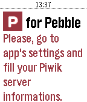

<!-- Generated by scripts/update_app_directory.py: do not edit by hand -->
[← All Pebble Developers](../developers.md)

# MrRaph\_

*1 app · Last updated 2026-10-12 · [About these lists](../about-app-lists.md)*

Links: [Pebble App Store](https://apps.repebble.com/apps/dev/mrraph_552293bf40edc5f1ca000034) · [GitHub (Branlala)](https://github.com/Branlala) · [Website (techan.fr)](https://techan.fr)

<h2 class="app-name" id="app-574ec5bc02b51fb2af000006"><a href="https://apps.repebble.com/574ec5bc02b51fb2af000006">Piwik for Pebble</a> v1.1</h2>
<a class="app-source" href="https://github.com/Branlala/Piwik-for-Pebble" title="Source code" data-search-exclude>View source</a>

App

No licence Released 2016-06-01 Updated 2016-06-03

Runs on: Round 2, Time 2, Pebble 2 Duo, Pebble 2, Time Round, Time, Classic

Simple app that display Piwik daily statistics for a given website. There&#x27;s currently only one screen that displays website&#x27;s visits summary. More screen with more stats will come next ! :-)

