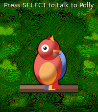
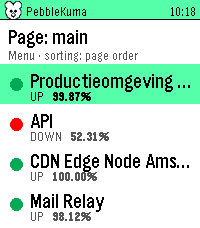
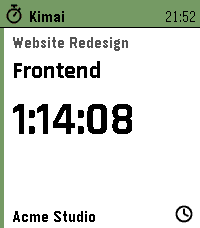
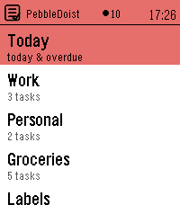
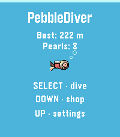
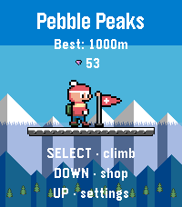
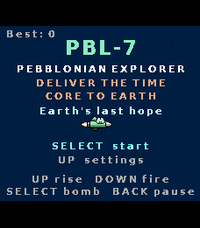
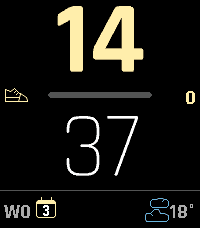

<!-- Generated by scripts/update_app_directory.py: do not edit by hand -->
[← All Pebble Developers](../developers.md)

# mrTrueBeliever

*1 watchface and 8 apps · Last updated 2026-10-12 · [About these lists](../about-app-lists.md)*

Links: [Pebble App Store](https://apps.repebble.com/apps/dev/mrtruebeliever_5f8814a92a6f109602136f61) · [GitHub (mrtruebeliever)](https://github.com/mrtruebeliever)

<button type="button" data-filter="all" aria-pressed="true">All 9</button><button type="button" data-filter="watchface" aria-pressed="false">Watchfaces 1</button><button type="button" data-filter="watchapp" aria-pressed="false">Apps 8</button>

<label class="dev-sort">Sort by <select><option value="updated">Recently updated</option><option value="released">Newest release</option><option value="title">A–Z</option></select></label>

<h2 class="app-name" id="app-98a5501cdace41fea679452d"><a href="https://apps.repebble.com/98a5501cdace41fea679452d">Polly</a> v1.5.1</h2>
<a class="app-source" href="https://github.com/mrtruebeliever/Polly" title="Source code" data-search-exclude>View source</a>

App

Released 2026-06-08 Updated 2026-10-12

Runs on: Time 2

Polly — your talking parrot Press SELECT, speak a sentence, and Polly repeats it out loud through your Pebble Time 2&#x27;s speaker in real, natural-sounding speech. Powered by Google Cloud…

<h2 class="app-name" id="app-81a2a1cef20f45b4935929e7"><a href="https://apps.repebble.com/81a2a1cef20f45b4935929e7">PebbleKuma</a> v1.3.0</h2>
<a class="app-source" href="https://github.com/mrtruebeliever/PebbleKuma" title="Source code" data-search-exclude>View source</a>

App

Released 2026-06-05 Updated 2026-10-12

Runs on: Round 2, Time 2, Pebble 2 Duo

Your Uptime Kuma status page, on your wrist. Watch your Uptime Kuma monitors from your Pebble: uptime, ping and heartbeats per monitor, with status-coloured cards. Touch on PT2. PebbleKuma shows…

<h2 class="app-name" id="app-4ab5c72a6eb74d5581ebcf6d"><a href="https://apps.repebble.com/4ab5c72a6eb74d5581ebcf6d">PebbleKimai</a> v2.10.0</h2>
<a class="app-source" href="https://github.com/mrtruebeliever/PebbleKimai" title="Source code" data-search-exclude>View source</a>

App

Released 2026-07-19 Updated 2026-10-12

Runs on: Round 2, Time 2, Pebble 2 Duo, Pebble 2, Time Round, Time, Classic

Track your time in Kimai, straight from your wrist. Start, stop and switch Kimai time tracking from your Pebble. Recent activities in one press. Touch on PT2. 5 languages. PebbleKimai puts your…

<h2 class="app-name" id="app-62a96010e98448ebaaa647fb"><a href="https://apps.repebble.com/62a96010e98448ebaaa647fb">PebbleDoist</a> v1.7.0</h2>
<a class="app-source" href="https://github.com/mrtruebeliever/PebbleDoist" title="Source code" data-search-exclude>View source</a>

App

Released 2026-07-14 Updated 2026-10-12

Runs on: Round 2, Time 2, Pebble 2 Duo

Your Todoist tasks on your wrist — add them by voice. Browse Todoist by list, label or Today, read details and subtasks, tick tasks off, and dictate new ones. Touch on PT2. 5 languages…

<h2 class="app-name" id="app-d529bfb1bcb14e369c9ac112"><a href="https://apps.repebble.com/d529bfb1bcb14e369c9ac112">PebbleDiver</a> v1.3.0</h2>
<a class="app-source" href="https://github.com/mrtruebeliever/PebbleDiver" title="Source code" data-search-exclude>View source</a>

App

Released 2026-07-20 Updated 2026-10-12

Runs on: Round 2, Time 2

A one-button deep-sea dive. Hold to swim up, let go to sink. Dodge rocks and jellyfish, grab pearls and air, upgrade your gear, and dive as deep as you dare. PebbleDiver is a one-button arcade…

<h2 class="app-name" id="app-ed51ec43c4a949fe9f265a8b"><a href="https://apps.repebble.com/ed51ec43c4a949fe9f265a8b">Pebble Peaks</a> v1.1.0</h2>
<a class="app-source" href="https://github.com/mrtruebeliever/PebblePeaks" title="Source code" data-search-exclude>View source</a>

App

Released 2026-10-12 Updated 2026-10-12

Runs on: Round 2, Time 2

Jump. Climb. Don&#x27;t freeze! Jump ledge to ledge up a mountain with two buttons while freezing mist rises below. Collect gems, buy gear, plant the flag at 1000 m. Pebble Peaks is a vertical arcade…

<h2 class="app-name" id="app-3cbee0195ebb4709be91f6d2"><a href="https://apps.repebble.com/3cbee0195ebb4709be91f6d2">PBL-7</a> v1.2.0</h2>
<a class="app-source" href="https://github.com/mrtruebeliever/PBL-7" title="Source code" data-search-exclude>View source</a>

App

Released 2026-07-22 Updated 2026-10-12

Runs on: Round 2, Time 2

A landscape shmup through the solar system. Hold your Pebble Time 2 sideways and fly PBL-7 to Earth. Rise, fire, dodge, and beat a boss on every planet. 11 planets, secrets, 5 languages. PBL-7 is…

<h2 class="app-name" id="app-6d8da4ce71164976855a854e"><a href="https://apps.repebble.com/6d8da4ce71164976855a854e">Demi</a> v1.8.0</h2>
<a class="app-source" href="https://github.com/mrtruebeliever/pebble-demi" title="Source code" data-search-exclude>View source</a>

Watchface

Released 2026-06-03 Updated 2026-10-12

Runs on: Round 2, Time 2, Pebble 2 Duo

A vector watchface that tracks whatever matters to you. Bold vector digits with progress bars for steps, daylight, battery or your own JSON stat - plus weather, sunrise/sunset and a light theme…

<h2 class="app-name" id="app-707660e759f249eb85df1b04"><a href="https://apps.repebble.com/707660e759f249eb85df1b04">Cairn</a> v1.3.1</h2>
<a class="app-source" href="https://github.com/mrtruebeliever/Cairn" title="Source code" data-search-exclude>View source</a>

App

Released 2026-07-25 Updated 2026-10-12

Runs on: Round 2, Time 2, Pebble 2 Duo

Cairn turns a breathing exercise into a tide. Start a session and the waterline rises while you inhale and falls while you exhale, uncovering a cairn of stones on the shore — no counting, no timer…

