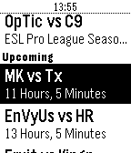
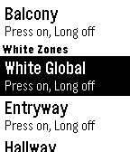

<!-- Generated by scripts/update_app_directory.py: do not edit by hand -->
[← All Pebble Developers](../developers.md)

# MrWhale

*2 apps · Last updated 2026-10-11 · [About these lists](../about-app-lists.md)*

Links: [Pebble App Store](https://apps.repebble.com/apps/dev/mrwhale_5309702c24c4582908000149) · [GitHub (mrwhale)](https://github.com/mrwhale)

<button type="button" data-filter="all" aria-pressed="true">All 2</button><button type="button" data-filter="watchface" aria-pressed="false" disabled>Watchfaces 0</button><button type="button" data-filter="watchapp" aria-pressed="false">Apps 2</button>

<label class="dev-sort">Sort by <select><option value="updated">Recently updated</option><option value="released">Newest release</option><option value="title">A–Z</option></select></label>

<h2 class="app-name" id="app-57c24bc35e3c3db4850002af"><a href="https://apps.repebble.com/57c24bc35e3c3db4850002af">CSontheGO</a> v1.0</h2>
<a class="app-source" href="https://github.com/mrwhale/CS-on-the-GO" title="Source code" data-search-exclude>View source</a>

App

Released 2016-08-28 Updated 2019-07-24

Runs on: Time 2, Pebble 2 Duo, Pebble 2, Time, Classic

Pebble app to display upcoming, live and completed CSGO (Counter Strike Global Offensive) match details Displays all upcoming CSGO match information, as well as completed match information with…

<h2 class="app-name" id="app-576e0ad06c21042b7b00000e"><a href="https://apps.repebble.com/576e0ad06c21042b7b00000e">Light-Controller (BETA)</a> v0.9</h2>
<a class="app-source" href="https://github.com/mrwhale/pebble-light-controller" title="Source code" data-search-exclude>View source</a>

App

Released 2016-06-25 Updated 2016-09-22

Runs on: Round 2, Time 2, Pebble 2 Duo, Pebble 2, Time Round, Time, Classic

Control your LimitelessLED, milight or EasyBulb lights with your pebble! This is currently the BETA build, so only has basic functionality working (on/off) but there is colourful UI to come! (This…

