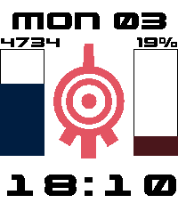

<!-- Generated by scripts/update_app_directory.py: do not edit by hand -->
[← All Pebble Developers](../developers.md)

# MrXANA91

*1 watchface · Last updated 2026-10-11 · [About these lists](../about-app-lists.md)*

Links: [Pebble App Store](https://apps.repebble.com/apps/dev/mrxana91_68ea761d5a79a800082886f5) · [GitHub (MrXANA91)](https://github.com/MrXANA91)

<h2 class="app-name" id="app-691ccd3ff5dd2700091a4ff2"><a href="https://apps.repebble.com/691ccd3ff5dd2700091a4ff2">Code XANA</a> v0.6.0</h2>
<a class="app-source" href="https://github.com/MrXANA91/pebble-codexana-wf" title="Source code" data-search-exclude>View source</a>

Watchface · <a href="https://forum.rebble.io/t/1212" title="Discuss this app on the Rebble forum" data-search-exclude>Forum thread</a>

MIT Released 2025-11-18 Updated 2026-08-14

Runs on: Round 2, Time 2, Pebble 2 Duo, Pebble 2, Time Round, Time, Classic

Code Lyoko themed watchface with the eye of XANA in the center. Code XANA will display the time (24h or 12h format automatically detected), the date, the battery level and the steps counter, all…

