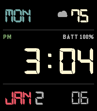

<!-- Generated by scripts/update_app_directory.py: do not edit by hand -->
[← All Pebble Developers](../developers.md)

# mstewart

*1 watchface · Last updated 2026-10-12 · [About these lists](../about-app-lists.md)*

Links: [Rebble App Store](https://apps.rebble.io/en_US/developer/6aa35f0d17875e0009b098fd/1) · [GitHub (mpstewart)](https://github.com/mpstewart)

<h2 class="app-name" id="app-6aa4bd364185ac000967dd9e"><a href="https://apps.rebble.io/en_US/application/6aa4bd364185ac000967dd9e">Cassiopeia</a> v1.0.0</h2>
<a class="app-source" href="https://github.com/mpstewart/cassiopeia" title="Source code" data-search-exclude>View source</a>

Watchface · <a href="https://forum.rebble.io/t/1348" title="Discuss this app on the Rebble forum" data-search-exclude>Forum thread</a>

Released 2026-09-12 Updated 2026-09-12 Rebble App Store

Runs on: Time 2

Digital watchface for the Pebble Time 2 Emery, inspired by the Casio W221H. Gruvbox colorscheme. Always-on backlight toggle with custom color.

