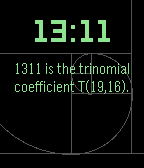

<!-- Generated by scripts/update_app_directory.py: do not edit by hand -->
[← All Pebble Developers](../developers.md)

# Muniba Khan

*1 watchface · Last updated 2026-10-11 · [About these lists](../about-app-lists.md)*

Links: [Rebble App Store](https://apps.rebble.io/en_US/developer/59922281461a8d9e49000e20/1) · [GitHub (kmuniba98)](https://github.com/kmuniba98)

<h2 class="app-name" id="app-5a2421aa0dfc32823d0036e7"><a href="https://apps.rebble.io/en_US/application/5a2421aa0dfc32823d0036e7">Math Facts Watchface</a> v2.0</h2>
<a class="app-source" href="https://github.com/kmuniba98/math-facts-watchface" title="Source code" data-search-exclude>View source</a>

Watchface

Released 2017-12-03 Updated 2017-12-03 Rebble App Store

Runs on: Round 2, Time 2, Time Round, Time

A Pebble watch-face displaying math and trivia facts associated with the current time.

