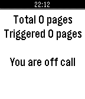

<!-- Generated by scripts/update_app_directory.py: do not edit by hand -->
[← All Pebble Developers](../developers.md)

# Murat Mukhtarov

*1 app · Last updated 2026-10-12 · [About these lists](../about-app-lists.md)*

Links: [Pebble App Store](https://apps.repebble.com/apps/dev/murat-mukhtarov_56dbcb65f92cb6a1a4000003) · [GitHub (murat1985)](https://github.com/murat1985)

<h2 class="app-name" id="app-574bec916037e86f0c000002"><a href="https://apps.repebble.com/574bec916037e86f0c000002">PagerDuty JS</a> v1.1</h2>
<a class="app-source" href="https://github.com/murat1985/pebblejs-pagerduty" title="Source code" data-search-exclude>View source</a>

App

Released 2016-05-30 Updated 2016-05-31

Runs on: Time 2, Pebble 2 Duo, Pebble 2, Time, Classic

Receive incidents and view them as cards on your Pebble Watch; Acknowledge an incident when you received it; Acknowledge all incidents; App will show you how long you are going to be on-call - and…

