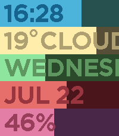

<!-- Generated by scripts/update_app_directory.py: do not edit by hand -->
[← All Pebble Developers](../developers.md)

# Mykhailo Drachuk

*1 watchface · Last updated 2026-10-12 · [About these lists](../about-app-lists.md)*

Links: [Pebble App Store](https://apps.repebble.com/apps/dev/mykhailo-drachuk_9e3d305635159ade03431f7c) · [GitHub (mdrachuk)](https://github.com/mdrachuk)

<h2 class="app-name" id="app-76cc105b9c6f498083b3af83"><a href="https://apps.repebble.com/76cc105b9c6f498083b3af83">Progress</a> v1.3.0</h2>
<a class="app-source" href="https://github.com/mdrachuk/peblife" title="Source code" data-search-exclude>View source</a>

Watchface

Released 2026-07-13 Updated 2026-07-24

Runs on: Time 2, Pebble 2 Duo, Pebble 2, Time, Classic

Day, week, season and lifetime progress bars at a glance.

