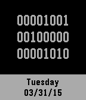

<!-- Generated by scripts/update_app_directory.py: do not edit by hand -->
[← All Pebble Developers](../developers.md)

# MyNameIsKir

*1 watchface · Last updated 2026-10-12 · [About these lists](../about-app-lists.md)*

Links: [Pebble App Store](https://apps.repebble.com/apps/dev/mynameiskir_53aa268766d85a7d240000f2) · [GitHub (MyNameIsKir)](https://github.com/MyNameIsKir)

<h2 class="app-name" id="app-551acc563488fa184a000092"><a href="https://apps.repebble.com/551acc563488fa184a000092">Binary Watch</a> v1.3</h2>
<a class="app-source" href="https://github.com/MyNameIsKir/Pebble-Binary-Watch-C" title="Source code" data-search-exclude>View source</a>

Watchface

No licence Released 2015-03-31 Updated 2015-06-09

Runs on: Time 2, Pebble 2 Duo, Pebble 2, Time, Classic

A binary watch face for those not interested in binary coded decimal. Features 12 and 24 hour modes. Perfect for those trying to memorize binary.

