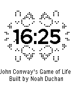

<!-- Generated by scripts/update_app_directory.py: do not edit by hand -->
[← All Pebble Developers](../developers.md)

# N-MAN

*1 watchface · Last updated 2026-10-12 · [About these lists](../about-app-lists.md)*

Links: [Pebble App Store](https://apps.repebble.com/apps/dev/n-man_5343952817842f00fb000039) · [GitHub (nduchan)](https://github.com/nduchan)

<h2 class="app-name" id="app-54cbfac659d1df5b6a000028"><a href="https://apps.repebble.com/54cbfac659d1df5b6a000028">Game of Life</a> v1.0</h2>
<a class="app-source" href="https://github.com/nduchan/Conway" title="Source code" data-search-exclude>View source</a>

Watchface

Released 2015-01-30 Updated 2015-01-30

Runs on: Time 2, Pebble 2 Duo, Pebble 2, Time, Classic

This watchface displays the time overlaid on a running simulation of John Conway&#x27;s Game of Life. Shake the watch to reset the game to one of three initial setups. Rules of the Game of Life: For…

