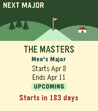

<!-- Generated by scripts/update_app_directory.py: do not edit by hand -->
[← All Pebble Developers](../developers.md)

# N3evin

*1 app · Last updated 2026-10-12 · [About these lists](../about-app-lists.md)*

Links: [Pebble App Store](https://apps.repebble.com/apps/dev/n3evin_1e7cf5109777745902ea406c) · [GitHub (N3evin)](https://github.com/N3evin) · [Website (pebblegolflive.n3evin.com)](https://pebblegolflive.n3evin.com/)

<h2 class="app-name" id="app-80828e5b66b947ed982d4941"><a href="https://apps.repebble.com/80828e5b66b947ed982d4941">Pebble Golf Live</a> v0.0.6</h2>
<a class="app-source" href="https://github.com/N3evin/Pebble-Golf-Live" title="Source code" data-search-exclude>View source</a>

App · <a href="https://forum.rebble.io/t/1411" title="Discuss this app on the Rebble forum" data-search-exclude>Forum thread</a>

No licence Released 2026-10-07 Updated 2026-10-11

Runs on: Round 2, Time 2

Follow live pro golf, leaderboards and player scores right from your wrist. ⛳ Pebble Golf Live brings tournament leaderboards, player scores, schedules and scorecards to your Pebble. Highlights: •…

