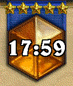

<!-- Generated by scripts/update_app_directory.py: do not edit by hand -->
[← All Pebble Developers](../developers.md)

# n4ru

*1 watchface and 1 app · Last updated 2026-10-11 · [About these lists](../about-app-lists.md)*

Links: [Pebble App Store](https://apps.repebble.com/apps/dev/n4ru_52c5a1cc0a89c8025a000049) · [GitLab (n4ru)](https://gitlab.com/n4ru)

<button type="button" data-filter="all" aria-pressed="true">All 2</button><button type="button" data-filter="watchface" aria-pressed="false">Watchfaces 1</button><button type="button" data-filter="watchapp" aria-pressed="false">Apps 1</button>

<label class="dev-sort">Sort by <select><option value="updated">Recently updated</option><option value="released">Newest release</option><option value="title">A–Z</option></select></label>

<h2 class="app-name" id="app-55d3560c704e4657a3000013"><a href="https://apps.repebble.com/55d3560c704e4657a3000013">flicks</a> v0.05</h2>
<a class="app-source" href="https://gitlab.com/n4ru/Flicks" title="Source code" data-search-exclude>View source</a>

App

Released 2015-08-18 Updated 2016-12-13

Runs on: Time 2, Pebble 2 Duo, Pebble 2, Time, Classic

Introducing flicks - a watch app created to do whatever you want whenever you want - right on your wrist. flicks is a fully configurable and scriptable app that lets you quick launch anything on…

<h2 class="app-name" id="app-55de1ab0785abd20ce000078"><a href="https://apps.repebble.com/55de1ab0785abd20ce000078">Hearthstone Legend</a> v1.03</h2>
<a class="app-source" href="https://gitlab.com/n4ru/Hearthstone-Legend" title="Source code" data-search-exclude>View source</a>

Watchface

Released 2015-08-26 Updated 2015-08-27

Runs on: Time 2, Pebble 2 Duo, Pebble 2, Time, Classic

A simplistic Hearthstone watchface. Stars indicate battery status: 5 stars &gt; 90% 4 stars &gt; 70% 3 stars &gt; 50% 2 stars &gt; 30% 1 star &gt; 10% Add me on Hearthstone - Thirk#1334 !

