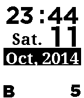

<!-- Generated by scripts/update_app_directory.py: do not edit by hand -->
[← All Pebble Developers](../developers.md)

# nab.aki

*1 watchface · Last updated 2026-10-12 · [About these lists](../about-app-lists.md)*

Links: [Pebble App Store](https://apps.repebble.com/apps/dev/nab-aki_53d4376df6e5bb57dd0000c1) · [Website (sites.google.com)](https://sites.google.com/site/nabakiaw/pebbleapl/thebigface)

<h2 class="app-name" id="app-5426db4cd7b4b066dc0000cd"><a href="https://apps.repebble.com/5426db4cd7b4b066dc0000cd">Big Face</a> v2.1</h2>
<a class="app-source" href="https://sites.google.com/site/nabakiaw/pebbleapl/thebigface#source" title="Source code" data-search-exclude>View source</a>

Watchface

Released 2014-09-27 Updated 2014-10-11

Runs on: Time 2, Pebble 2 Duo, Pebble 2, Time, Classic

I create a simple Watchface for my middle-aged eyes. 1st line: Time 2nd line: a day of week and day 3rd line: Month and year Bottom line: BlueTooth connection Battery Status If bluetooth…

