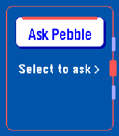

<!-- Generated by scripts/update_app_directory.py: do not edit by hand -->
[← All Pebble Developers](../developers.md)

# Namka

*1 app · Last updated 2026-10-12 · [About these lists](../about-app-lists.md)*

Links: [Rebble App Store](https://apps.rebble.io/en_US/developer/6a061bb94787e50008f7f373/1) · [GitHub (s-titanium-74)](https://github.com/s-titanium-74)

<h2 class="app-name" id="app-6a2764f6d2556100093bfbf5"><a href="https://apps.rebble.io/en_US/application/6a2764f6d2556100093bfbf5">Ask Pebble</a> v1.0.2</h2>
<a class="app-source" href="https://github.com/s-titanium-74/ask-pebble" title="Source code" data-search-exclude>View source</a>

App · <a href="https://forum.rebble.io/t/1036" title="Discuss this app on the Rebble forum" data-search-exclude>Forum thread</a>

Released 2026-06-09 Updated 2026-07-20 Rebble App Store

Runs on: Time 2, Pebble 2 Duo

Ask Pebble turns Pebble Dictation into a compact AI Q&amp;A flow. Press Select, speak a question, and the app sends the recognized text from PebbleKit JS on your paired Android phone to the API…

