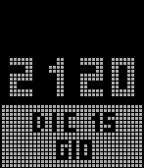

<!-- Generated by scripts/update_app_directory.py: do not edit by hand -->
[← All Pebble Developers](../developers.md)

# Nastas

*1 watchface · Last updated 2026-10-11 · [About these lists](../about-app-lists.md)*

Links: [Rebble App Store](https://apps.rebble.io/en_US/developer/584192efca3094ca290000e1/1) · [GitHub (VFLashM)](https://github.com/VFLashM)

<h2 class="app-name" id="app-5852e9b4ce45dc2c6300014b"><a href="https://apps.rebble.io/en_US/application/5852e9b4ce45dc2c6300014b">TetrisTime_ITA</a> v1.2</h2>
<a class="app-source" href="https://github.com/VFLashM/TetrisTime" title="Source code" data-search-exclude>View source</a>

Watchface

MIT Released 2016-12-15 Updated 2016-12-16 Rebble App Store

Runs on: Time 2, Pebble 2 Duo, Pebble 2, Time, Classic

TetrisTime ora con giorni della settimana e mesi completamente in Italiano! Guarda i tetriminos cadere dall&#x27;alto formando l&#x27;ora corrente. Nelle impostazioni potete scegliere se e come visualizzare…

