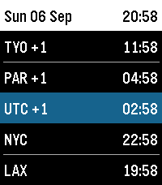

<!-- Generated by scripts/update_app_directory.py: do not edit by hand -->
[← All Pebble Developers](../developers.md)

# Nate Gay

*1 watchface · Last updated 2026-10-12 · [About these lists](../about-app-lists.md)*

Links: [Pebble App Store](https://apps.repebble.com/apps/dev/nate-gay_944ac793331e6c5243804ad2) · [GitHub (nateinaction)](https://github.com/nateinaction)

<h2 class="app-name" id="app-f747afcc10d24c91ad30d88c"><a href="https://apps.repebble.com/f747afcc10d24c91ad30d88c">Frequent Traveler</a> v1.1.0</h2>
<a class="app-source" href="https://github.com/nateinaction/frequent-traveler-watchface" title="Source code" data-search-exclude>View source</a>

Watchface

Released 2026-09-05 Updated 2026-09-07

Runs on: Time 2, Pebble 2 Duo, Time

A multi-timezone watch face for frequent travelers. Shows local time and up to five additional time zones. When local time matches a configured time zone, that row will be hidden. Rows have a…

