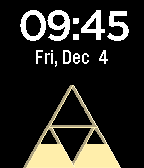

<!-- Generated by scripts/update_app_directory.py: do not edit by hand -->
[← All Pebble Developers](../developers.md)

# Nate Walck

*2 watchfaces · Last updated 2026-10-12 · [About these lists](../about-app-lists.md)*

Links: [Pebble App Store](https://apps.repebble.com/apps/dev/nate-walck_548288410a62debed8000040) · [GitHub (natewalck)](https://github.com/natewalck)

<button type="button" data-filter="all" aria-pressed="true">All 2</button><button type="button" data-filter="watchface" aria-pressed="false">Watchfaces 2</button><button type="button" data-filter="watchapp" aria-pressed="false" disabled>Apps 0</button>

<label class="dev-sort">Sort by <select><option value="updated">Recently updated</option><option value="released">Newest release</option><option value="title">A–Z</option></select></label>

<h2 class="app-name" id="app-56620a47e7a5f692eb000088"><a href="https://apps.repebble.com/56620a47e7a5f692eb000088">Triforce Time</a> v1.1</h2>
<a class="app-source" href="https://github.com/natewalck/PebbleTimeTriforce" title="Source code" data-search-exclude>View source</a>

Watchface

Released 2015-12-04 Updated 2017-05-04

Runs on: Round 2, Time 2, Pebble 2 Duo, Pebble 2, Time Round, Time, Classic

Triforce Advanced update for the Pebble and Pebble Time.

<h2 class="app-name" id="app-54a9f5caae94cf312800010d"><a href="https://apps.repebble.com/54a9f5caae94cf312800010d">Two</a> v1.0</h2>
<a class="app-source" href="https://github.com/natewalck/PebbleFaceTwo" title="Source code" data-search-exclude>View source</a>

Watchface

Released 2015-01-05 Updated 2015-01-05

Runs on: Time 2, Pebble 2 Duo, Pebble 2, Time, Classic

Simple watchface with a trippy pattern. Shows the date, temp outside (using GPS) and battery life.

