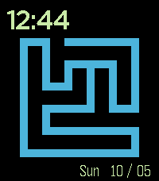

<!-- Generated by scripts/update_app_directory.py: do not edit by hand -->
[← All Pebble Developers](../developers.md)

# Nathan Clisby

*1 watchface · Last updated 2026-10-11 · [About these lists](../about-app-lists.md)*

Links: [Pebble App Store](https://apps.repebble.com/apps/dev/nathan-clisby_88e8beeb5488b9a79d9a262b) · [GitHub (nclisby)](https://github.com/nclisby)

<h2 class="app-name" id="app-22ece92835ce4d6f9bb49696"><a href="https://apps.repebble.com/22ece92835ce4d6f9bb49696">Hamiltonian path</a> v1.0</h2>
<a class="app-source" href="https://github.com/nclisby/hp_pebble/" title="Source code" data-search-exclude>View source</a>

Watchface

Released 2026-05-10 Updated 2026-05-10

Runs on: Time 2

Displays a Hamiltonian path on a 6x6 grid, sampled via the so-called backbite algorithm.

