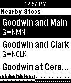

<!-- Generated by scripts/update_app_directory.py: do not edit by hand -->
[← All Pebble Developers](../developers.md)

# Nathan Handler

*1 watchface and 1 app · Last updated 2026-10-12 · [About these lists](../about-app-lists.md)*

Links: [Pebble App Store](https://apps.repebble.com/apps/dev/nathan-handler_530d1fe7d3b642ac1a000335) · [GitHub (nhandler)](https://github.com/nhandler) · [Website (hackillinois.org)](http://www.hackillinois.org/)

<button type="button" data-filter="all" aria-pressed="true">All 2</button><button type="button" data-filter="watchface" aria-pressed="false">Watchfaces 1</button><button type="button" data-filter="watchapp" aria-pressed="false">Apps 1</button>

<label class="dev-sort">Sort by <select><option value="updated">Recently updated</option><option value="released">Newest release</option><option value="title">A–Z</option></select></label>

<h2 class="app-name" id="app-533f81d2cb6cd3fb2b0001b4"><a href="https://apps.repebble.com/533f81d2cb6cd3fb2b0001b4">Pebble CUMTD</a> v1.1</h2>
<a class="app-source" href="https://github.com/nhandler/pebble-cumtd" title="Source code" data-search-exclude>View source</a>

App

Released 2014-04-05 Updated 2015-03-03

Runs on: Time 2, Pebble 2 Duo, Pebble 2, Time, Classic

Locate the nearest Champaign-Urbana Mass Transit District (CUMTD) bus stop, and then view upcoming bus departure times.

<h2 class="app-name" id="app-533ea3692804d179bb0002e8"><a href="https://apps.repebble.com/533ea3692804d179bb0002e8">HackIllinois</a> v1.2.1</h2>
<a class="app-source" href="https://github.com/nhandler/hackillinois" title="Source code" data-search-exclude>View source</a>

Watchface

Released 2014-04-04 Updated 2014-04-08

Runs on: Time 2, Pebble 2 Duo, Pebble 2, Time, Classic

On April 11th, join several hundred hackers in fostering the creative spirit that’s changing the world. HackIllinois is about creating something you’re passionate about. Come spend 36 hours…

