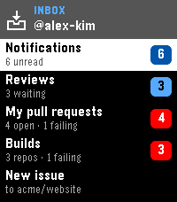

<!-- Generated by scripts/update_app_directory.py: do not edit by hand -->
[← All Pebble Developers](../developers.md)

# nathanm95

*1 app · Last updated 2026-11-23 · [About these lists](../about-app-lists.md)*

Links: [Pebble App Store](https://apps.repebble.com/apps/dev/nathanm95_1e5330b4a5bb50cb1062b1d8) · [GitHub (nathanm95)](https://github.com/nathanm95)

<h2 class="app-name" id="app-6bf539405d624c098322ae59"><a href="https://apps.repebble.com/6bf539405d624c098322ae59">Inbox for GitHub</a> v1.0.0</h2>
<a class="app-source" href="https://github.com/nathanm95/pebble-inbox-for-github" title="Source code" data-search-exclude>View source</a>

App

MIT Released 2026-11-20 Updated 2026-11-20

Runs on: Round 2, Time 2, Pebble 2 Duo, Pebble 2, Time Round, Time

Your GitHub notifications, reviews, pull request checks and builds on your wrist, with voice replies, plus a plugin for any watchface. Unofficial: not affiliated with GitHub.

