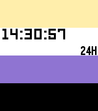

<!-- Generated by scripts/update_app_directory.py: do not edit by hand -->
[← All Pebble Developers](../developers.md)

# Navi

*1 watchface · Last updated 2026-10-12 · [About these lists](../about-app-lists.md)*

Links: [Pebble App Store](https://apps.repebble.com/apps/dev/navi_b3393bc4fd6cdfba84690531)

<h2 class="app-name" id="app-dcc54a5bf69e4b6693702929"><a href="https://apps.repebble.com/dcc54a5bf69e4b6693702929">Enby</a> v1.7.0</h2>
<a class="app-source" href="https://git.kescher.at/kescher/enby-watchface" title="Source code" data-search-exclude>View source</a>

Watchface · <a href="https://forum.rebble.io/t/1004" title="Discuss this app on the Rebble forum" data-search-exclude>Forum thread</a>

Released 2026-05-27 Updated 2026-05-29

Runs on: Round 2, Time 2, Time Round, Time

This watchface helps you show your non-binary pride on your Pebble with a multi-color display. Features: - Non-binary flag - Show seconds on tap, switch back to hours and minutes only after 15…

