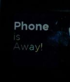

<!-- Generated by scripts/update_app_directory.py: do not edit by hand -->
[← All Pebble Developers](../developers.md)

# Nazaret Vaz

*1 watchface · Last updated 2026-10-12 · [About these lists](../about-app-lists.md)*

Links: [Pebble App Store](https://apps.repebble.com/apps/dev/nazaret-vaz_52f06c123fbdba0ccb0019c9) · [GitHub (nazaretvaz)](https://github.com/nazaretvaz)

<h2 class="app-name" id="app-5318b9e495b1eacb1000000e"><a href="https://apps.repebble.com/5318b9e495b1eacb1000000e">TextWatchBT</a> v2.0.0</h2>
<a class="app-source" href="https://github.com/nazaretvaz/TextWatchBT" title="Source code" data-search-exclude>View source</a>

Watchface

Released 2014-03-06 Updated 2014-03-07

Runs on: Time 2, Pebble 2 Duo, Pebble 2, Time, Classic

TextWatch Face with Proximity. If your phone is out of Bluetooth range, it displays a message+vibrates+turns the backlight on. This is based on PebbleTextWatch by wearewip.

