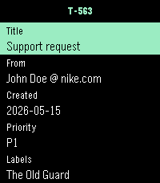

<!-- Generated by scripts/update_app_directory.py: do not edit by hand -->
[← All Pebble Developers](../developers.md)

# ndom91

*1 app · Last updated 2026-10-11 · [About these lists](../about-app-lists.md)*

Links: [Pebble App Store](https://apps.repebble.com/apps/dev/ndom91_a36d646258c3a87fa9ed2e25) · [GitHub (ndom91)](https://github.com/ndom91)

<h2 class="app-name" id="app-77adb361a9aa4038b0f9cecf"><a href="https://apps.repebble.com/77adb361a9aa4038b0f9cecf">Plain</a> v1.0.5</h2>
<a class="app-source" href="https://github.com/ndom91/pebble-plain" title="Source code" data-search-exclude>View source</a>

App

Released 2026-06-06 Updated 2026-06-07

Runs on: Round 2, Time 2

Plain for Pebble shows your Plain TODO support threads on the watch, including thread references, titles, customer metadata, labels, assignees, and recent messages. Requires a Plain machine-user…

