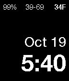

<!-- Generated by scripts/update_app_directory.py: do not edit by hand -->
[← All Pebble Developers](../developers.md)

# Neal Enssle

*1 watchface · Last updated 2026-10-11 · [About these lists](../about-app-lists.md)*

Links: [Pebble App Store](https://apps.repebble.com/apps/dev/neal-enssle_55ea329d2ad21a07c7000062) · [GitHub (nealenssle)](https://github.com/nealenssle) · [Website (neal.enssle.me)](http://neal.enssle.me)

<h2 class="app-name" id="app-55f7928ca0c71be4de000039"><a href="https://apps.repebble.com/55f7928ca0c71be4de000039">Requisite</a> v1.5</h2>
<a class="app-source" href="https://github.com/nealenssle/pebble-requisite" title="Source code" data-search-exclude>View source</a>

Watchface

Released 2015-09-15 Updated 2015-10-19

Runs on: Time 2, Pebble 2 Duo, Pebble 2, Time, Classic

A simple, basic, minimalist watch face with time and date in Helvetica Neue font. The watch face includes a battery indicator and now shows current temperature and low-high temperature with data…

