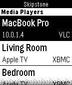
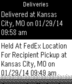
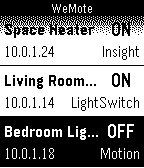
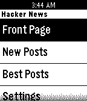
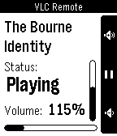

<!-- Generated by scripts/update_app_directory.py: do not edit by hand -->
[← All Pebble Developers](../developers.md)

# Neal Patel

*9 apps · Last updated 2026-10-12 · [About these lists](../about-app-lists.md)*

Links: [Pebble App Store](https://apps.repebble.com/apps/dev/neal-patel_528feeab8a8c0b97c8000005) · [GitHub (Neal)](https://github.com/Neal) · [GitHub (Skipstone)](https://github.com/Skipstone) · [Website (ineal.me)](http://ineal.me/pebble/opalx)

<button type="button" data-filter="all" aria-pressed="true">All 9</button><button type="button" data-filter="watchface" aria-pressed="false" disabled>Watchfaces 0</button><button type="button" data-filter="watchapp" aria-pressed="false">Apps 9</button>

<label class="dev-sort">Sort by <select><option value="updated">Recently updated</option><option value="released">Newest release</option><option value="title">A–Z</option></select></label>

<h2 class="app-name" id="app-53328f8e07233daf4b00020e"><a href="https://apps.repebble.com/53328f8e07233daf4b00020e">OpalX</a> v1.0.3</h2>
<a class="app-source" href="https://github.com/Neal/OpalX" title="Source code" data-search-exclude>View source</a>

App

MIT Released 2014-03-26 Updated 2025-12-01

Runs on: Time 2, Pebble 2 Duo, Pebble 2, Time, Classic

A LIFX remote app. Control all LIFX lights on your network! Toggle them or change the colors from your wrist. No companion app needed. It uses the LIFX HTTP API (find instructions on how to…

<h2 class="app-name" id="app-52f1095ba0cb6abe6d002f05"><a href="https://apps.repebble.com/52f1095ba0cb6abe6d002f05">Skipstone</a> v2.5</h2>
<a class="app-source" href="https://github.com/Skipstone/Skipstone" title="Source code" data-search-exclude>View source</a>

App

MIT Released 2014-02-04 Updated 2015-02-09

Runs on: Time 2, Pebble 2 Duo, Pebble 2, Time, Classic

A fully featured universal media player remote watch app that allows you to control Plex, VLC, XBMC and WDTV. Skipstone is an open-source project by @petehare, @spangborn, and @iNeal. Source code…

<h2 class="app-name" id="app-52f9c21e8bc57c9c820000db"><a href="https://apps.repebble.com/52f9c21e8bc57c9c820000db">Readebble</a> v2.2</h2>
<a class="app-source" href="https://github.com/Neal/Readebble" title="Source code" data-search-exclude>View source</a>

App

MIT Released 2014-02-11 Updated 2015-01-13

Runs on: Time 2, Pebble 2 Duo, Pebble 2, Time, Classic

A multiple source RSS reader for Pebble that allows you to read the headlines of your favorite feeds and a summarized story for each headline. *NEW: Pocket support. Add items to your Pocket by…

<h2 class="app-name" id="app-5435bc7926edd83fea0000ab"><a href="https://apps.repebble.com/5435bc7926edd83fea0000ab">Tinder for Pebble</a> v0.2</h2>
<a class="app-source" href="https://github.com/Neal/pebble-tinder" title="Source code" data-search-exclude>View source</a>

App

MIT Released 2014-10-08 Updated 2014-12-11

Runs on: Time 2, Pebble 2 Duo, Pebble 2, Time, Classic

A Tinder app for Pebble that allows you to like, pass and view profiles on the go! Coming soon: read messages, send preset messages, change preferences and much more! Disclaimer: Not affiliated…

<h2 class="app-name" id="app-52b2b797cd41833d960000cb"><a href="https://apps.repebble.com/52b2b797cd41833d960000cb">Deliveries</a> v2.1</h2>
<a class="app-source" href="https://github.com/Neal/pebble-deliveries" title="Source code" data-search-exclude>View source</a>

App

MIT Released 2013-12-19 Updated 2014-11-02

Runs on: Time 2, Pebble 2 Duo, Pebble 2, Time, Classic

An on-demand universal package tracker. Supports several carriers across the world including UPS, FedEx, DHL, USPS, TNT, Canada Post, China Post, Hongkong Post, Japan Post, Australia Post, Royal…

<h2 class="app-name" id="app-52fcf2182ace7a838f000123"><a href="https://apps.repebble.com/52fcf2182ace7a838f000123">WeMote</a> v1.0.3</h2>
<a class="app-source" href="https://github.com/Neal/WeMote" title="Source code" data-search-exclude>View source</a>

App

MIT Released 2014-02-13 Updated 2014-02-17

Runs on: Time 2, Pebble 2 Duo, Pebble 2, Time, Classic

A remote app to flip your WeMo switches from your wrist. Works with all WeMo products. WeMote requires the Ouimeaux REST API running on a computer on the network to be able to work. Guide to…

<h2 class="app-name" id="app-52b2b6b28c081570bb0000e0"><a href="https://apps.repebble.com/52b2b6b28c081570bb0000e0">Hacker News</a> v1.1.0</h2>
<a class="app-source" href="https://github.com/Neal/pebble-hackernews" title="Source code" data-search-exclude>View source</a>

App

MIT Released 2013-12-19 Updated 2014-01-21

Runs on: Time 2, Pebble 2 Duo, Pebble 2, Time, Classic

Hacker News reader for Pebble! Read the front page, new, and best stories on Hacker News now right on your wrist!

<h2 class="app-name" id="app-52b2b725b70e1cbfca0000f1"><a href="https://apps.repebble.com/52b2b725b70e1cbfca0000f1">Breaking News</a> v1.0.5</h2>
<a class="app-source" href="https://github.com/Neal/pebble-breakingnews" title="Source code" data-search-exclude>View source</a>

App

No licence Released 2013-12-19 Updated 2014-01-20

Runs on: Time 2, Pebble 2 Duo, Pebble 2, Time, Classic

Breaking News for Pebble. Read the main feed from breakingnews.com on your wrist now!

<h2 class="app-name" id="app-52960f40bcd790ff41000007"><a href="https://apps.repebble.com/52960f40bcd790ff41000007">VLC Remote</a> v1.3.2</h2>
<a class="app-source" href="https://github.com/Neal/pebble-vlc-remote" title="Source code" data-search-exclude>View source</a>

App

No licence Released 2013-11-27 Updated 2013-12-14

Runs on: Time 2, Pebble 2 Duo, Pebble 2, Time, Classic

This app has been merged with Skipstone and is no longer maintained. Please use Skipstone instead. --------- A remote control watch app for VLC Media Player which allows you to toggle play/pause…

