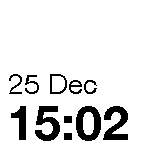
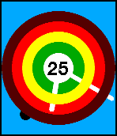
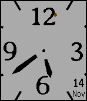
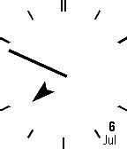

<!-- Generated by scripts/update_app_directory.py: do not edit by hand -->
[← All Pebble Developers](../developers.md)

# Neale Pickett

*6 watchfaces · Last updated 2026-10-12 · [About these lists](../about-app-lists.md)*

Links: [Pebble App Store](https://apps.repebble.com/apps/dev/neale-pickett_5550deeae979af7f6f000047) · [GitHub (nealey)](https://github.com/nealey)

<button type="button" data-filter="all" aria-pressed="true">All 6</button><button type="button" data-filter="watchface" aria-pressed="false">Watchfaces 6</button><button type="button" data-filter="watchapp" aria-pressed="false" disabled>Apps 0</button>

<label class="dev-sort">Sort by <select><option value="updated">Recently updated</option><option value="released">Newest release</option><option value="title">A–Z</option></select></label>

<h2 class="app-name" id="app-567daaad0bdc466e39000346"><a href="https://apps.repebble.com/567daaad0bdc466e39000346">Twatch Fonts</a> v1.6</h2>
<a class="app-source" href="https://github.com/nealey/TwatchFonts" title="Source code" data-search-exclude>View source</a>

Watchface

Released 2015-12-25 Updated 2016-10-21

Runs on: Round 2, Time 2, Pebble 2 Duo, Pebble 2, Time Round, Time, Classic

I love well-hinted fonts. This face features a selectable collection of my favorite free fonts: Helvetica, Avería, and Ubuntu. Features selectable color themes and Bluetooth dropout notification.

<h2 class="app-name" id="app-573221b582fa531249000023"><a href="https://apps.repebble.com/573221b582fa531249000023">Twatch Chalice</a> v1.5</h2>
<a class="app-source" href="https://github.com/nealey/TwatchChalice" title="Source code" data-search-exclude>View source</a>

Watchface

Released 2016-05-10 Updated 2016-06-03

Runs on: Round 2, Time 2, Pebble 2 Duo, Pebble 2, Time Round, Time, Classic

A blocky face with the date and Bluetooth dropout notification. Inspired by Sam Jerichow&#x27;s super-cool &quot;Soto X&quot; face

<h2 class="app-name" id="app-573635af9ec4c104c9000021"><a href="https://apps.repebble.com/573635af9ec4c104c9000021">Twatch Toik</a> v1.4</h2>
<a class="app-source" href="https://github.com/nealey/TwatchToik" title="Source code" data-search-exclude>View source</a>

Watchface

Released 2016-05-13 Updated 2016-05-16

Runs on: Round 2, Time 2, Pebble 2 Duo, Pebble 2, Time Round, Time, Classic

tick tock tick tock tick tock

<h2 class="app-name" id="app-567de93d0bdc46ec540003ff"><a href="https://apps.repebble.com/567de93d0bdc46ec540003ff">Twatch Rings</a> v1.4</h2>
<a class="app-source" href="https://github.com/nealey/TwatchRings" title="Source code" data-search-exclude>View source</a>

Watchface

Released 2015-12-26 Updated 2016-05-10

Runs on: Round 2, Time 2, Pebble 2 Duo, Pebble 2, Time Round, Time, Classic

A clone of Pebble&#x27;s Color Rings face, with date, seconds, and vibration when you walk away from your phone.

<h2 class="app-name" id="app-5647d6f05064faceb4000016"><a href="https://apps.repebble.com/5647d6f05064faceb4000016">Twatch Epsilon</a> v1.5</h2>
<a class="app-source" href="http://github.com/nealey/Twatch" title="Source code" data-search-exclude>View source</a>

Watchface

No licence Released 2015-11-15 Updated 2016-03-10

Runs on: Round 2, Time 2, Pebble 2 Duo, Pebble 2, Time Round, Time, Classic

Analog face, featuring the beautiful Avería serif font. All colors are configurable, so you can change from the nice default color scheme into your own personal fruit salad. If your pebble is set…

<h2 class="app-name" id="app-559b3050071c85eea80000ab"><a href="https://apps.repebble.com/559b3050071c85eea80000ab">Twatch Gamma</a> v1.0</h2>
<a class="app-source" href="https://github.com/nealey/Twatch" title="Source code" data-search-exclude>View source</a>

Watchface

Released 2015-07-07 Updated 2015-07-07

Runs on: Time 2, Pebble 2 Duo, Pebble 2, Time, Classic

My very first Analog watch face. I hate it, but some people seem to like it. Maybe you&#x27;re one of them!

