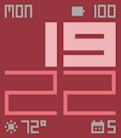

<!-- Generated by scripts/update_app_directory.py: do not edit by hand -->
[← All Pebble Developers](../developers.md)

# Neema

*1 watchface · Last updated 2026-10-12 · [About these lists](../about-app-lists.md)*

Links: [Pebble App Store](https://apps.repebble.com/apps/dev/neema_acf4d290d5c2f2f1938365ed) · [GitHub (leeja328)](https://github.com/leeja328)

<h2 class="app-name" id="app-62b4e87511724b988c0a8b02"><a href="https://apps.repebble.com/62b4e87511724b988c0a8b02">Momentous</a> v1.0.0</h2>
<a class="app-source" href="https://github.com/leeja328/momentous" title="Source code" data-search-exclude>View source</a>

Watchface

Released 2026-10-06 Updated 2026-10-06

Runs on: Round 2, Time 2, Pebble 2 Duo, Pebble 2, Time Round, Time, Classic

This watch face was inspired by Moment, created by Luke Harris. I love the block style that gives excellent readability and contrast, but I was sad that its settings page no longer worked and that…

