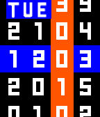
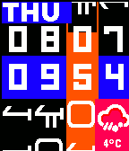
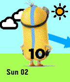

<!-- Generated by scripts/update_app_directory.py: do not edit by hand -->
[← All Pebble Developers](../developers.md)

# Neon

*7 watchfaces · Last updated 2026-10-12 · [About these lists](../about-app-lists.md)*

Links: [Pebble App Store](https://apps.repebble.com/apps/dev/neon_5568037a1034b0abf70000a1) · [GitHub (sdneon)](https://github.com/sdneon)

<button type="button" data-filter="all" aria-pressed="true">All 7</button><button type="button" data-filter="watchface" aria-pressed="false">Watchfaces 7</button><button type="button" data-filter="watchapp" aria-pressed="false" disabled>Apps 0</button>

<label class="dev-sort">Sort by <select><option value="updated">Recently updated</option><option value="released">Newest release</option><option value="title">A–Z</option></select></label>

<h2 class="app-name" id="app-56fea0cf0f5be2595800002e"><a href="https://apps.repebble.com/56fea0cf0f5be2595800002e">Barcelona</a> v1.0</h2>
<a class="app-source" href="https://github.com/sdneon/Barcelona/" title="Source code" data-search-exclude>View source</a>

Watchface

Released 2016-04-01 Updated 2016-04-05

Runs on: Time 2, Time

Barcelona football club inspired watch face for Pebble Time. (Colour, Digital). Watch face looks similar to Barcelona&#x27;s crest, with a little fun. The examples show (1) 8:25am, Bluetooth connected…

<h2 class="app-name" id="app-56ff9ad23ca6fda7bd00002e"><a href="https://apps.repebble.com/56ff9ad23ca6fda7bd00002e">Arsenal</a> v1.0</h2>
<a class="app-source" href="https://github.com/sdneon/Arsenal" title="Source code" data-search-exclude>View source</a>

Watchface

Released 2016-04-02 Updated 2016-04-05

Runs on: Time 2, Time

Arsenal inspired watch face for Pebble Time. (Colour, Digital). Watch face with Arsenal colours. The examples show (1) 9:20pm, Bluetooth connected, battery level ok, (2) 1806H (24-h style). - Red…

<h2 class="app-name" id="app-5591f56d981ce4e8510000ca"><a href="https://apps.repebble.com/5591f56d981ce4e8510000ca">Enigma+</a> v2.6</h2>
<a class="app-source" href="https://github.com/sdneon/Enigma-plus" title="Source code" data-search-exclude>View source</a>

Watchface

Released 2015-06-30 Updated 2015-09-09

Runs on: Time 2, Time

Enigma watch face variant with more information displayed. (Colour, Digital, for Pebble Time). Added info: - date (includes weekday name, date in ddmm format, and year or dual time in separate…

<h2 class="app-name" id="app-5591f845981ce4e8510000cd"><a href="https://apps.repebble.com/5591f845981ce4e8510000cd">Enigma+ Rosetta</a> v2.3</h2>
<a class="app-source" href="https://github.com/sdneon/Enigma-Klingon" title="Source code" data-search-exclude>View source</a>

Watchface

Released 2015-06-30 Updated 2015-08-08

Runs on: Time 2, Time

Enigma+ digital, colour watch face variant with choices of alien text for Sci-Fi fans. Optional hourly vibrations (configurable timings), and vibration (fading pulse) on Bluetooth disconnection…

<h2 class="app-name" id="app-55a8e0b20dc1ce2feb000095"><a href="https://apps.repebble.com/55a8e0b20dc1ce2feb000095">Super Minions</a> v1.2</h2>
<a class="app-source" href="https://github.com/sdneon/Minions" title="Source code" data-search-exclude>View source</a>

Watchface

Released 2015-07-17 Updated 2015-08-03

Runs on: Time 2, Time

Minions are small, yellow pill-like creatures who have existed since the beginning of time. Now a super breed* invades Pebble Times. The super heroes&#x27; bum shows the current hour, and an unique…

<h2 class="app-name" id="app-5591fa14981ce42c590000c9"><a href="https://apps.repebble.com/5591fa14981ce42c590000c9">No Hands (has weather)</a> v1.5</h2>
<a class="app-source" href="https://github.com/sdneon/NoHands" title="Source code" data-search-exclude>View source</a>

Watchface

Released 2015-06-30 Updated 2015-07-26

Runs on: Time 2, Time

Simple analogue watch with coloured sectors and hour hint. (Colour, Analogue, for Pebble Time). Now with optional vibrations and weather. Sample times in screenshots are: 10:30PM, 8:34AM, 10:25AM…

<h2 class="app-name" id="app-5593b2ee57dd91bb42000023"><a href="https://apps.repebble.com/5593b2ee57dd91bb42000023">Teddy Bear</a> v1.1</h2>
<a class="app-source" href="https://github.com/sdneon/TeddyBear" title="Source code" data-search-exclude>View source</a>

Watchface

Released 2015-07-01 Updated 2015-07-01

Runs on: Time 2, Time

Teddy bear tells the time. Teddy&#x27;s face shows the hour in numerals, and a hand points to the minutes. Backgrounds colour pairs changes on the hour. E.g. the screenshot would be 5:04 (i.e. 5…

