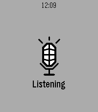
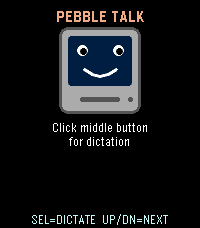

<!-- Generated by scripts/update_app_directory.py: do not edit by hand -->
[← All Pebble Developers](../developers.md)

# Neonfire

*2 apps · Last updated 2026-10-12 · [About these lists](../about-app-lists.md)*

Links: [Pebble App Store](https://apps.repebble.com/apps/dev/neonfire_eb9220b4f504a68bcfd99cec) · [GitHub (neonfire42)](https://github.com/neonfire42)

<button type="button" data-filter="all" aria-pressed="true">All 2</button><button type="button" data-filter="watchface" aria-pressed="false" disabled>Watchfaces 0</button><button type="button" data-filter="watchapp" aria-pressed="false">Apps 2</button>

<label class="dev-sort">Sort by <select><option value="updated">Recently updated</option><option value="released">Newest release</option><option value="title">A–Z</option></select></label>

<h2 class="app-name" id="app-2d83367c2e4a408a807bd2e5"><a href="https://apps.repebble.com/2d83367c2e4a408a807bd2e5">qnote</a> v1.2.2</h2>
<a class="app-source" href="https://github.com/neonfire42/qnote" title="Source code" data-search-exclude>View source</a>

App

Released 2026-09-02 Updated 2026-09-04

Runs on: Time 2

Speak a note into your Pebble. It&#x27;s on your phone before you lower your wrist. Opening qnote starts dictation immediately - no menu, no button to find first. Speak, confirm the transcription, and…

<h2 class="app-name" id="app-23692844dacf4630bbd80f96"><a href="https://apps.repebble.com/23692844dacf4630bbd80f96">PebbleTalk</a> v1.1.0</h2>
<a class="app-source" href="https://github.com/neonfire42/pebbletalk" title="Source code" data-search-exclude>View source</a>

App

Released 2026-06-09 Updated 2026-06-09

Runs on: Time 2

A tiny retro speech synthesizer that talks through the Pebble Time 2 speaker. Fully algorithmic MacinTalk-style formant synthesis: no samples, no internet, just math. Press Select to hear the…

