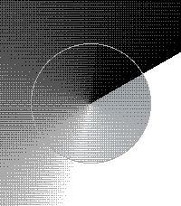
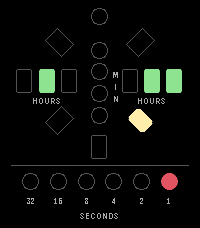

<!-- Generated by scripts/update_app_directory.py: do not edit by hand -->
[← All Pebble Developers](../developers.md)

# NetNoise

*3 watchfaces · Last updated 2026-10-11 · [About these lists](../about-app-lists.md)*

Links: [Pebble App Store](https://apps.repebble.com/apps/dev/netnoise_164926ef742b9ab422a9bacb) · [GitHub (GeoffAtLarge)](https://github.com/GeoffAtLarge)

<button type="button" data-filter="all" aria-pressed="true">All 3</button><button type="button" data-filter="watchface" aria-pressed="false">Watchfaces 3</button><button type="button" data-filter="watchapp" aria-pressed="false" disabled>Apps 0</button>

<label class="dev-sort">Sort by <select><option value="updated">Recently updated</option><option value="released">Newest release</option><option value="title">A–Z</option></select></label>

<h2 class="app-name" id="app-52423694fd1c4395afd81b43"><a href="https://apps.repebble.com/52423694fd1c4395afd81b43">Solus_v2</a> v2.2.0</h2>
<a class="app-source" href="https://github.com/GeoffAtLarge/pebble-solus-v2" title="Source code" data-search-exclude>View source</a>

Watchface

No licence Released 2026-06-04 Updated 2026-10-05

Runs on: Round 2, Time 2

An artistic watchface built for the Pebble Time 2 and Pebble Round 2 Animation configuration was added along with battery and memory optimizations Based on Solus by Graham-Bryan

<h2 class="app-name" id="app-cbd7840a45424bae97f459ec"><a href="https://apps.repebble.com/cbd7840a45424bae97f459ec">Penumbra</a> v1.0.0</h2>
<a class="app-source" href="https://github.com/GeoffAtLarge/pebble-gradient-watchface" title="Source code" data-search-exclude>View source</a>

Watchface

No licence Released 2026-10-05 Updated 2026-10-05

Runs on: Round 2, Time 2, Time Round, Time

Penumbra tells the time with light and shadow. Each hand is a soft gradient disc that starts solid at the hand and fades away around the dial. Read the hour and minute from where the fades begin…

<h2 class="app-name" id="app-2ee3a721b23b44968487102b"><a href="https://apps.repebble.com/2ee3a721b23b44968487102b">Alien Clock</a> v1.2.0</h2>
<a class="app-source" href="https://github.com/GeoffAtLarge/pebble-alien-clock" title="Source code" data-search-exclude>View source</a>

Watchface

No licence Released 2026-09-22 Updated 2026-09-22

Runs on: Round 2, Time 2

A watchface to emulate the Alien Clock as seen on Star Trek: Deep Space Nine. This working prop was made by the Alien Time Company in 1995 and I&#x27;m fortunate enough to own one. I thought it would…

