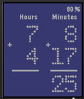

<!-- Generated by scripts/update_app_directory.py: do not edit by hand -->
[← All Pebble Developers](../developers.md)

# NewAndy

*1 watchface · Last updated 2026-10-11 · [About these lists](../about-app-lists.md)*

Links: [Pebble App Store](https://apps.repebble.com/apps/dev/newandy_52f20b8b0bbfec410900116c) · [GitHub (NewAndy)](https://github.com/NewAndy)

<h2 class="app-name" id="app-556a9c7ad2d833200f000099"><a href="https://apps.repebble.com/556a9c7ad2d833200f000099">MathTime</a> v2.1</h2>
<a class="app-source" href="https://github.com/NewAndy/MathTime" title="Source code" data-search-exclude>View source</a>

Watchface

No licence Released 2015-05-31 Updated 2015-06-07

Runs on: Time 2, Pebble 2 Duo, Pebble 2, Time, Classic

MathTime watchface with basic math operations. Bluetooth connection check. Battery usage icon.

