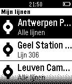

<!-- Generated by scripts/update_app_directory.py: do not edit by hand -->
[← All Pebble Developers](../developers.md)

# Nexworx

*1 app · Last updated 2026-10-11 · [About these lists](../about-app-lists.md)*

Links: [Rebble App Store](https://apps.rebble.io/en_US/developer/52bf1b94f31c32267f000094/1) · [GitHub (DriesOeyen)](https://github.com/DriesOeyen) · [Website (nexworx.com)](https://nexworx.com)

<h2 class="app-name" id="app-54736f68c13ebfe8f5000091"><a href="https://apps.rebble.io/en_US/application/54736f68c13ebfe8f5000091">De Lijn</a> v1.6</h2>
<a class="app-source" href="https://github.com/DriesOeyen/delijn-pebble" title="Source code" data-search-exclude>View source</a>

App

No licence Released 2014-11-24 Updated 2015-09-16 Rebble App Store

Runs on: Time 2, Pebble 2 Duo, Pebble 2, Time, Classic

Check snel real-time doorkomsten van bus of tram aan je favoriete haltes van De Lijn – onmiddellijk op je Pebble. Deze app is onafhankelijk ontwikkeld en wordt niet beheerd of ondersteund door…

