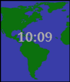
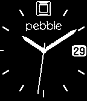
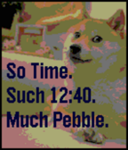

<!-- Generated by scripts/update_app_directory.py: do not edit by hand -->
[← All Pebble Developers](../developers.md)

# Nicholas Currault

*6 watchfaces · Last updated 2026-10-12 · [About these lists](../about-app-lists.md)*

Links: [Pebble App Store](https://apps.repebble.com/apps/dev/nicholas-currault_52c908c66025fc11fa00003a) · [GitHub (nicktendo64)](https://github.com/nicktendo64)

<button type="button" data-filter="all" aria-pressed="true">All 6</button><button type="button" data-filter="watchface" aria-pressed="false">Watchfaces 6</button><button type="button" data-filter="watchapp" aria-pressed="false" disabled>Apps 0</button>

<label class="dev-sort">Sort by <select><option value="updated">Recently updated</option><option value="released">Newest release</option><option value="title">A–Z</option></select></label>

<h2 class="app-name" id="app-54168166247a034d440000be"><a href="https://apps.repebble.com/54168166247a034d440000be">Not Sure if AM or PM</a> v2.2</h2>
<a class="app-source" href="https://github.com/nicktendo64/not-sure-if/" title="Source code" data-search-exclude>View source</a>

Watchface

Released 2014-09-15 Updated 2015-12-16

Runs on: Round 2, Time 2, Pebble 2 Duo, Pebble 2, Time Round, Time, Classic

This watchface is based on the &quot;not sure if&quot; Internet meme, which is in turn based on the TV series Futurama. Inspired by a reddit post: http://redd.it/2g6igt Made with CloudPebble.

<h2 class="app-name" id="app-565e1d8f5629c976ea00007c"><a href="https://apps.repebble.com/565e1d8f5629c976ea00007c">tempus latinum</a> v1.0</h2>
<a class="app-source" href="https://github.com/nicktendo64/tempus-latinum" title="Source code" data-search-exclude>View source</a>

Watchface

Released 2015-12-01 Updated 2015-12-01

Runs on: Time 2, Pebble 2 Duo, Pebble 2, Time, Classic

This watchface displays the current time and date in the format that Ancient Romans would have used. All numbers are in Latin/Roman Numerals, the months and days are in Latin, and dates are…

<h2 class="app-name" id="app-541781d497ecd489f0000020"><a href="https://apps.repebble.com/541781d497ecd489f0000020">World Time: 9-5</a> v1.0</h2>
<a class="app-source" href="https://github.com/nicktendo64/World-Time" title="Source code" data-search-exclude>View source</a>

Watchface

Released 2014-09-16 Updated 2015-07-04

Runs on: Time 2, Time

This app, based on http://xkcd.com/1335/, shows where in the world it&#x27;s business hours. It is only available on color watches because the older watches&#x27; operating systems only know local time.

<h2 class="app-name" id="app-556905267802ba7fb700006f"><a href="https://apps.repebble.com/556905267802ba7fb700006f">Classy Sweep</a> v1.0</h2>
<a class="app-source" href="http://github.com/nicktendo64/classy-sweep" title="Source code" data-search-exclude>View source</a>

Watchface

MIT Released 2015-05-30 Updated 2015-05-30

Runs on: Time 2, Pebble 2 Duo, Pebble 2, Time, Classic

For a classy touch to your watch, this face uses a &quot;sweeping&quot; second hand (one that moves continuously, rather than once per second). It also features a number at 3 o&#x27;clock, which displays the day…

<h2 class="app-name" id="app-54167f6b9796f6619d0000a8"><a href="https://apps.repebble.com/54167f6b9796f6619d0000a8">Such Time</a> v2.0</h2>
<a class="app-source" href="https://github.com/nicktendo64/such-time" title="Source code" data-search-exclude>View source</a>

Watchface

Released 2014-09-15 Updated 2015-03-28

Runs on: Time 2, Pebble 2 Duo, Pebble 2, Time, Classic

A watchface based on Doge, an Internet sensation. Made with CloudPebble

<h2 class="app-name" id="app-54177f240ba7a964af000020"><a href="https://apps.repebble.com/54177f240ba7a964af000020">Party time!</a> v1.0</h2>
<a class="app-source" href="https://github.com/nicktendo64/party-time" title="Source code" data-search-exclude>View source</a>

Watchface

Released 2014-09-16 Updated 2014-09-16

Runs on: Time 2, Pebble 2 Duo, Pebble 2, Time, Classic

This watchface flashes once per second and contains both the current time and the text &quot;Party Time!&quot;.

