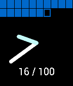

<!-- Generated by scripts/update_app_directory.py: do not edit by hand -->
[← All Pebble Developers](../developers.md)

# Nicholas Edwards

*1 watchface · Last updated 2026-10-11 · [About these lists](../about-app-lists.md)*

Links: [Rebble App Store](https://apps.rebble.io/en_US/developer/56234efcd2a8ff4d8a000027/1) · [GitHub (edwardsnjd)](https://github.com/edwardsnjd)

<h2 class="app-name" id="app-5844c28e00355aeb3d000980"><a href="https://apps.rebble.io/en_US/application/5844c28e00355aeb3d000980">100 Blocks a Day</a> v0.1</h2>
<a class="app-source" href="https://github.com/edwardsnjd/100BlocksADayFace" title="Source code" data-search-exclude>View source</a>

Watchface

Released 2016-12-05 Updated 2016-12-05 Rebble App Store

Runs on: Round 2, Time 2, Time Round, Time

A simple 10x10 grid of blocks showing how many 10 minute blocks you&#x27;ve used today! Inspired by Tim Urban&#x27;s Wait but Why post, &quot;100 Blocks a Day&quot;.

