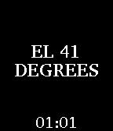
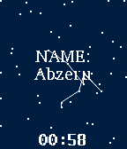

<!-- Generated by scripts/update_app_directory.py: do not edit by hand -->
[← All Pebble Developers](../developers.md)

# Nicholas Knouf

*3 watchfaces · Last updated 2026-10-12 · [About these lists](../about-app-lists.md)*

Links: [Rebble App Store](https://apps.rebble.io/en_US/developer/585045b977324b357a0004ae/1) · [GitHub (zeitkunst)](https://github.com/zeitkunst) · [Website (zeitkunst.org)](http://zeitkunst.org)

<button type="button" data-filter="all" aria-pressed="true">All 3</button><button type="button" data-filter="watchface" aria-pressed="false">Watchfaces 3</button><button type="button" data-filter="watchapp" aria-pressed="false" disabled>Apps 0</button>

<label class="dev-sort">Sort by <select><option value="updated">Recently updated</option><option value="released">Newest release</option><option value="title">A–Z</option></select></label>

<h2 class="app-name" id="app-59724027461a8d9e490001f5"><a href="https://apps.rebble.io/en_US/application/59724027461a8d9e490001f5">Every moment again (On Your Wrist is the Universe)</a> v0.1</h2>
<a class="app-source" href="https://github.com/zeitkunst/every_moment_again" title="Source code" data-search-exclude>View source</a>

Watchface

Released 2017-07-21 Updated 2017-07-21 Rebble App Store

Runs on: Time 2, Pebble 2 Duo, Pebble 2, Time, Classic

Consider your role in the universe by understanding the relationship between light from stars afar and your own history and future. On Your Wrist is the Universe: Every moment again is a watchface…

<h2 class="app-name" id="app-593448abb67f9f814d0009c5"><a href="https://apps.rebble.io/en_US/application/593448abb67f9f814d0009c5">Satellite Poems (On Your Wrist is the Universe)</a> v0.1</h2>
<a class="app-source" href="https://github.com/zeitkunst/satpoems-watchface" title="Source code" data-search-exclude>View source</a>

Watchface

Released 2017-06-04 Updated 2017-06-04 Rebble App Store

Runs on: Time 2, Pebble 2 Duo, Pebble 2, Time, Classic

(Follow | Feel | Know | Watch | Understand) the satellites above through computer-generated poetry. On Your Wrist is the Universe: Satellite Poems is a watchface that generates new poems based on…

<h2 class="app-name" id="app-59345bc3b67f9f9e810009cd"><a href="https://apps.rebble.io/en_US/application/59345bc3b67f9f9e810009cd">Constellation Poems (On Your Wrist is the Universe)</a> v0.1</h2>
<a class="app-source" href="https://github.com/zeitkunst/constellationpoems-watchface" title="Source code" data-search-exclude>View source</a>

Watchface

Released 2017-06-04 Updated 2017-06-04 Rebble App Store

Runs on: Time 2, Pebble 2 Duo, Pebble 2, Time, Classic

Imagine a universe with new constellations and develop new stories to describe them. On Your Wrist is the Universe: Constellation Poems is a watchface that generates constellations within random…

