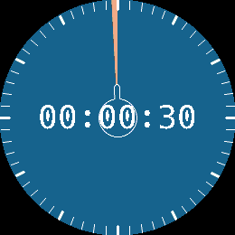

<!-- Generated by scripts/update_app_directory.py: do not edit by hand -->
[← All Pebble Developers](../developers.md)

# nichols-t

*1 app · Last updated 2026-10-12 · [About these lists](../about-app-lists.md)*

Links: [Pebble App Store](https://apps.repebble.com/apps/dev/unknown_584a110e19b7319580c4afa4) · [GitHub (nichols-t)](https://github.com/nichols-t)

<h2 class="app-name" id="app-8b210e928160473495d2fc80"><a href="https://apps.repebble.com/8b210e928160473495d2fc80">Timer</a> v1.0.0</h2>
<a class="app-source" href="https://github.com/nichols-t/timer" title="Source code" data-search-exclude>View source</a>

App

Released 2026-05-09 Updated 2026-05-09

Runs on: Round 2, Time 2, Pebble 2 Duo, Pebble 2, Time Round, Time, Classic

A minimal timer application inspired by physical rotational timers.

