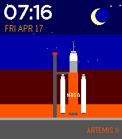

<!-- Generated by scripts/update_app_directory.py: do not edit by hand -->
[← All Pebble Developers](../developers.md)

# Nick Bachicha

*2 watchfaces · Last updated 2026-10-11 · [About these lists](../about-app-lists.md)*

Links: [Pebble App Store](https://apps.repebble.com/apps/dev/nick-bachicha_1020315d951b0c0f1b22addb) · [GitHub (nicksterx)](https://github.com/nicksterx)

<button type="button" data-filter="all" aria-pressed="true">All 2</button><button type="button" data-filter="watchface" aria-pressed="false">Watchfaces 2</button><button type="button" data-filter="watchapp" aria-pressed="false" disabled>Apps 0</button>

<label class="dev-sort">Sort by <select><option value="updated">Recently updated</option><option value="released">Newest release</option><option value="title">A–Z</option></select></label>

<h2 class="app-name" id="app-1a4930111a134151813ca2bf"><a href="https://apps.repebble.com/1a4930111a134151813ca2bf">50 States</a> v1.3</h2>
<a class="app-source" href="https://github.com/nicksterx/states-watchface" title="Source code" data-search-exclude>View source</a>

Watchface

Released 2026-04-10 Updated 2026-08-21

Runs on: Round 2, Time 2, Pebble 2 Duo, Pebble 2, Time Round, Time, Classic

Learn about the 50 states from your watch face. Each minute represents when the state joined the union. For example :01 is Delaware and :50 is Hawaii. Other territories and fun facts for minutes…

<h2 class="app-name" id="app-8e703bb113c84671900a754b"><a href="https://apps.repebble.com/8e703bb113c84671900a754b">Artemis II</a> v1.0</h2>
<a class="app-source" href="https://github.com/nicksterx/artemis-watchface" title="Source code" data-search-exclude>View source</a>

Watchface

Released 2026-04-18 Updated 2026-04-18

Runs on: Round 2, Time 2, Pebble 2 Duo, Pebble 2, Time Round, Time

A Live Artemis II Launch on your wrist every hour! This watch face has the famous T minus countdown and you get to watch it launch off the launch pad. This was my first time doing an animated…

