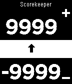

<!-- Generated by scripts/update_app_directory.py: do not edit by hand -->
[← All Pebble Developers](../developers.md)

# Nick Fajardo

*1 app · Last updated 2026-10-11 · [About these lists](../about-app-lists.md)*

Links: [Pebble App Store](https://apps.repebble.com/apps/dev/nick-fajardo_529a3928129af73ae30000c5) · [GitHub (saintnicster)](https://github.com/saintnicster)

<h2 class="app-name" id="app-529a56991695234d81000004"><a href="https://apps.repebble.com/529a56991695234d81000004">Dual Scorekeeper</a> v2.0.3</h2>
<a class="app-source" href="https://github.com/saintnicster/Pebble-Projects/tree/sdk2/dual_scorekeeper" title="Source code" data-search-exclude>View source</a>

App

Released 2013-11-30 Updated 2013-12-01

Runs on: Time 2, Pebble 2 Duo, Pebble 2, Time, Classic

Keep track of 2 player&#x27;s scores with this app on your watch. Scores are saved to the watch when switching apps Select button (middle click) to select which counter is being toggled. Hold down…

