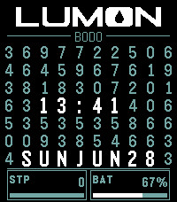
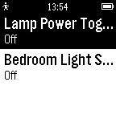

<!-- Generated by scripts/update_app_directory.py: do not edit by hand -->
[← All Pebble Developers](../developers.md)

# Nick Pappas

*1 watchface and 2 apps · Last updated 2026-10-12 · [About these lists](../about-app-lists.md)*

Links: [Pebble App Store](https://apps.repebble.com/apps/dev/nick-pappas_55079df5febe68ca0b0000a2) · [GitHub (radicand)](https://github.com/radicand)

<button type="button" data-filter="all" aria-pressed="true">All 3</button><button type="button" data-filter="watchface" aria-pressed="false">Watchfaces 1</button><button type="button" data-filter="watchapp" aria-pressed="false">Apps 2</button>

<label class="dev-sort">Sort by <select><option value="updated">Recently updated</option><option value="released">Newest release</option><option value="title">A–Z</option></select></label>

<h2 class="app-name" id="app-87e9be27ecf34f248efa8235"><a href="https://apps.repebble.com/87e9be27ecf34f248efa8235">LumonTime</a> v1.2.0</h2>
<a class="app-source" href="https://github.com/radicand/pebble-lumon" title="Source code" data-search-exclude>View source</a>

Watchface

Released 2026-05-24 Updated 2026-06-28

Runs on: Time 2

LUMONTIME™ — TEMPORAL INTERFACE SYSTEM A Lumon Industries Productivity Enhancement™ The LumonTime™ Temporal Interface represents the next generation in personal efficiency monitoring. Seamlessly…

<h2 class="app-name" id="app-2be94e8e7ac1453988aba54e"><a href="https://apps.repebble.com/2be94e8e7ac1453988aba54e">Monarch Net Worth</a> v1.2</h2>
<a class="app-source" href="https://github.com/radicand/pebble-monarch" title="Source code" data-search-exclude>View source</a>

App

Released 2026-04-12 Updated 2026-05-05

Runs on: Time 2

Quickly see your latest Net Worth figures from Monarch

<h2 class="app-name" id="app-55ec8deb4fcd1c6dc300004e"><a href="https://apps.repebble.com/55ec8deb4fcd1c6dc300004e">ZWay Control</a> v1.2</h2>
<a class="app-source" href="https://github.com/radicand/PebbleZWay" title="Source code" data-search-exclude>View source</a>

App

Released 2015-09-06 Updated 2015-09-26

Runs on: Time 2, Pebble 2 Duo, Pebble 2, Time, Classic

PLEASE NOTE: I no longer have a Z-Way system, I cannot verify whether this app still works. If you have one and want to take over maintenance, please reach out. --- New in 1.2: Fixed compatibility…

