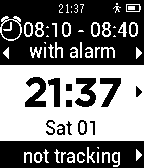

<!-- Generated by scripts/update_app_directory.py: do not edit by hand -->
[← All Pebble Developers](../developers.md)

# Nick Penkov

*1 app · Last updated 2026-10-11 · [About these lists](../about-app-lists.md)*

Links: [Rebble App Store](https://apps.rebble.io/en_US/developer/53ef190611cff6b7bd000063/1) · [GitHub (npenkov)](https://github.com/npenkov) · [Website (pebslee.com)](http://www.pebslee.com)

<h2 class="app-name" id="app-545674f5a13219e58b000099"><a href="https://apps.rebble.io/en_US/application/545674f5a13219e58b000099">Pinsleep</a> v1.10</h2>
<a class="app-source" href="https://github.com/npenkov/pebslee-pebble" title="Source code" data-search-exclude>View source</a>

App

Released 2014-11-02 Updated 2015-11-28 Rebble App Store

Runs on: Round 2, Time 2, Pebble 2 Duo, Pebble 2, Time Round, Time, Classic

Former PebSlee application. Smart sleep alarm and sleep tracking app with free Companion apps for fetching and syncing data with Apple HealthKit and Dropbox. Android and iOS Companion apps are…

