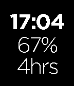

<!-- Generated by scripts/update_app_directory.py: do not edit by hand -->
[← All Pebble Developers](../developers.md)

# Nick Tikhonov

*1 watchface · Last updated 2026-10-11 · [About these lists](../about-app-lists.md)*

Links: [Pebble App Store](https://apps.repebble.com/apps/dev/nick-tikhonov_53092023fa74421daa0006a5) · [GitHub (nicktikhonov)](https://github.com/nicktikhonov)

<h2 class="app-name" id="app-5739ed4cc7050e9150000013"><a href="https://apps.repebble.com/5739ed4cc7050e9150000013">Save Time</a> v1.0</h2>
<a class="app-source" href="https://github.com/nicktikhonov/pebble-save-time" title="Source code" data-search-exclude>View source</a>

Watchface

Released 2016-05-16 Updated 2016-05-16

Runs on: Round 2, Time 2, Pebble 2 Duo, Pebble 2, Time Round, Time, Classic

Unofficial RescueTime watchface for your Pebble Time and Time Steel. Keep track of your productivity score and total work time from your wrist!

