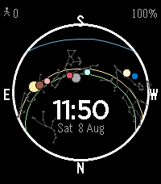
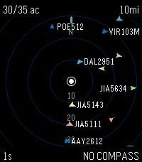

<!-- Generated by scripts/update_app_directory.py: do not edit by hand -->
[← All Pebble Developers](../developers.md)

# Nick Touran

*1 watchface and 1 app · Last updated 2026-10-12 · [About these lists](../about-app-lists.md)*

Links: [Rebble App Store](https://apps.rebble.io/en_US/developer/6a7749febaddf70009b25be8/1) · [GitHub (partofthething)](https://github.com/partofthething) · [Website (partofthething.com)](https://partofthething.com)

<button type="button" data-filter="all" aria-pressed="true">All 2</button><button type="button" data-filter="watchface" aria-pressed="false">Watchfaces 1</button><button type="button" data-filter="watchapp" aria-pressed="false">Apps 1</button>

<label class="dev-sort">Sort by <select><option value="updated">Recently updated</option><option value="released">Newest release</option><option value="title">A–Z</option></select></label>

<h2 class="app-name" id="app-6a7767bd1772b2000916c0b7"><a href="https://apps.rebble.io/en_US/application/6a7767bd1772b2000916c0b7">Skyfield</a> v3.0.5</h2>
<a class="app-source" href="https://github.com/partofthething/ha_skyfield/tree/master/pebble" title="Source code" data-search-exclude>View source</a>

Watchface · <a href="https://forum.rebble.io/t/1220" title="Discuss this app on the Rebble forum" data-search-exclude>Forum thread</a>

Released 2026-08-08 Updated 2026-08-17 Rebble App Store

Runs on: Round 2, Time 2, Pebble 2 Duo, Pebble 2, Time Round, Time, Classic

Shows the sun, moon, planets, and some stars move across the sky. Also shows the solstice sun paths. Optional steps, battery, heart rate, and temperature in corners. Requires data from external…

<h2 class="app-name" id="app-6a80ccf8d08b360009a90351"><a href="https://apps.rebble.io/en_US/application/6a80ccf8d08b360009a90351">Peb1090</a> v1.0.2</h2>
<a class="app-source" href="https://github.com/partofthething/peb1090" title="Source code" data-search-exclude>View source</a>

App · <a href="https://forum.rebble.io/t/1239" title="Discuss this app on the Rebble forum" data-search-exclude>Forum thread</a>

Released 2026-08-15 Updated 2026-08-17 Rebble App Store

Runs on: Round 2, Time 2, Pebble 2 Duo, Pebble 2, Time Round, Time, Classic

View flight data around you from a tar1090 server. This is generally useful for people who run ADS-B receivers themselves and want to plug into their own data, though it would work with a friend&#x27;s…

