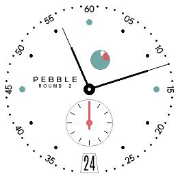
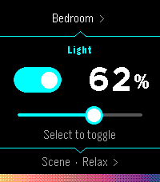
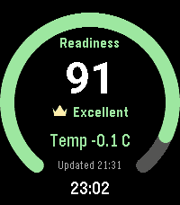

<!-- Generated by scripts/update_app_directory.py: do not edit by hand -->
[← All Pebble Developers](../developers.md)

# Nick Winans

*1 watchface and 3 apps · Last updated 2026-10-11 · [About these lists](../about-app-lists.md)*

Links: [Pebble App Store](https://apps.repebble.com/apps/dev/nick-winans_d41cec2e1676d30103d578c3) · [GitHub (Nicell)](https://github.com/Nicell) · [Website (ringview.winans.io)](https://ringview.winans.io)

<button type="button" data-filter="all" aria-pressed="true">All 4</button><button type="button" data-filter="watchface" aria-pressed="false">Watchfaces 1</button><button type="button" data-filter="watchapp" aria-pressed="false">Apps 3</button>

<label class="dev-sort">Sort by <select><option value="updated">Recently updated</option><option value="released">Newest release</option><option value="title">A–Z</option></select></label>

<h2 class="app-name" id="app-6ca65e90a29d45c6bf7e20b6"><a href="https://apps.repebble.com/6ca65e90a29d45c6bf7e20b6">Urban Reserve</a> v1.1.0</h2>
<a class="app-source" href="https://github.com/Nicell/urban-reserve-pebble" title="Source code" data-search-exclude>View source</a>

Watchface

No licence Released 2026-07-09 Updated 2026-07-25

Runs on: Round 2

A Round 2 Pebble watchface inspired by NOMOS Metro-style mechanical watch dials. Not affiliated with NOMOS Glashutte.

<h2 class="app-name" id="app-df31f62140dc46f295201620"><a href="https://apps.repebble.com/df31f62140dc46f295201620">Hueble</a> v1.0.1</h2>
<a class="app-source" href="https://github.com/Nicell/hueble" title="Source code" data-search-exclude>View source</a>

App

MIT Released 2026-07-20 Updated 2026-07-20

Runs on: Round 2, Time 2

Hueble is a focused, watch-first remote for Philips Hue. Open it directly into your last room, toggle its lights, adjust brightness, or activate a scene without reaching for your phone. Rooms and…

<h2 class="app-name" id="app-861415a105c74b7cb81ae436"><a href="https://apps.repebble.com/861415a105c74b7cb81ae436">RingView</a> v1.0.0</h2>
<a class="app-source" href="https://github.com/Nicell/ringview-pebble" title="Source code" data-search-exclude>View source</a>

App

MIT Released 2026-07-17 Updated 2026-07-17

Runs on: Round 2, Time 2

Selected Oura health summaries on your Pebble.

<h2 class="app-name" id="app-95d3bd263e9640008e394c8d"><a href="https://apps.repebble.com/95d3bd263e9640008e394c8d">Caltrain.app</a> v1.3.0</h2>
<a class="app-source" href="https://github.com/Nicell/caltrain-app-pebble" title="Source code" data-search-exclude>View source</a>

App

MIT Released 2026-07-10 Updated 2026-07-13

Runs on: Round 2, Time 2

Catch the right Caltrain from your wrist. Caltrain.app shows upcoming departures in one fast, glanceable list, with train details and a scrollable route timeline. With a phone connection, it can…

